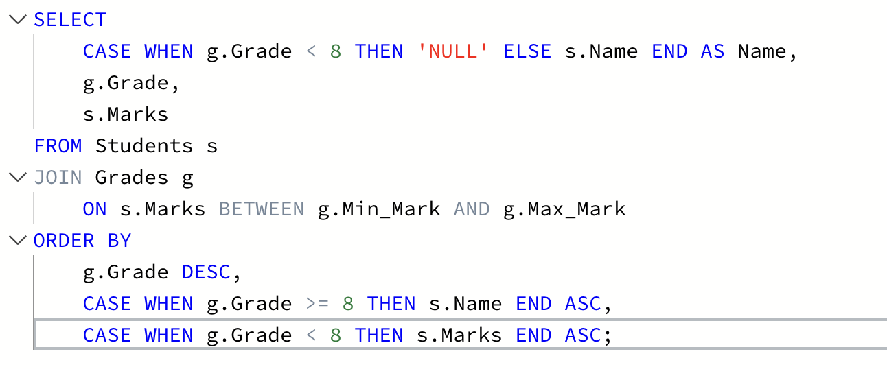

# Case Study Specialized SQL Techniques

### Terdapat 5 soal dan 2 Reflection Question yang harus dijawab

**Assignment Data Engineering DE16 · Day 18**

## Tentang Proyek

Repositori ini berisi pembahasan dan solusi SQL untuk lima soal dari HackerRank dan menjawab pertanyaan refleksi. Setiap query dilengkapi ringkasan tujuan dan konsep yang digunakan agar alur penyelesaiannya mudah diikuti.

> Fokus latihan: mengubah aturan soal menjadi query yang jelas, terstruktur, dan mudah dibaca.

## Isi Tantangan

| No. | Tantangan | Fokus SQL |
| --- | --- | --- |
| 1 | [The Report](#1-the-report) | `CASE`, `JOIN`, pengurutan bersyarat |
| 2 | [Weather Observation Station 18](#2-weather-observation-station-18) | Agregasi, fungsi matematika, pembulatan |
| 3 | [Top Competitor](#3-top-competitor) | Banyak `JOIN`, `COUNT DISTINCT`, `HAVING` |
| 4 | [Ollivanders' Inventory](#4-ollivanders-inventory) | Subquery berkorelasi, nilai minimum |
| 5 | [Contest Leaderboard](#5-contest-leaderboard) | Subquery, `MAX`, agregasi skor

## SOAL

### Soal 1: The Report

Soal meminta untuk membuat laporan dari data siswa. Laporan itu punya tiga kolom: Name, Grade, dan Marks.
Untuk membuat laporan itu, perlu mencari grade setiap siswa dari tabel Grades. Grade ditentukan berdasarkan rentang nilai. Contohnya, nilai 88 berada di rentang 80-89, jadi gradenya 9.

Setelah itu, tampilkan semua siswa dengan aturan berikut:
* Urutkan dari grade tertinggi ke terendah
* Untuk grade 8, 9, dan 10, tampilkan nama siswa. Jika gradenya sama, urutkan nama secara alfabetis
* Untuk grade di bawah 8, tampilkan NULL sebagai nama. Jika gradenya sama, urutkan berdasarkan nilai dari yang terkecil

Jadi yang diminta bukan menghitung rata - rata atau memilih siswa tertentu, tetapi membuat daftar semua siswa dengan grade mereka, lalu menyamarkan nama siswa yang gradenya dibawah 8 sesuai aturan tersebut.

Solusi Code:

Penjelasan:

Setiap siswa memiliki nilai, dan tugas kita adalah menentukan gradenya dengan mencocokkan nilai tersebut ke rentang nilai pada tabel Grades. Misalnya, nilai masuk ke rentang 80-89, jadi gradenya 9. Setelah itu, urutkan siswa berdasarkan grade dari tertinggi ke terendah. Untuk siswa dengan grade 8-10, tampilkan nama mereka dan urutkan secara alfabetis jika gradenya sama. Untuk siswa dengan grade di bawah 8, tampilkan NULL sebagai nama dan urutkan berdasarkan nilai  dari yang terkecil jika gradenya sama.

Hasil:

### Soal 2: Weather Observation Station 18

Soal ini meminta kita menghitung jarak Manhattan antara dua titik yang dibuentuk dari koordinat di tabel STATION

Titik pertama memakai latitude terkecil dan longitude terkecil. Titik kedua memakai latitude terbesar dan longitude terbesar. Jarak Manhattan dihitung dengan menjumlahkan selisih kedua koordinat: selisih latitude ditambah selisih longitude. Hasil akhirnya diminta dibulatkan menjadi 4 angka dibelakang koma.

Jadi tugasnya adalah mencari empat nilai minimum dan maksimum dari kolom LAT_N dan LONG_W, lalu memasukkannya ke rumus jarak tersebut.

Solusi Code:

Penjelasan:

Query ini mencari latitude dan longitude terkecil serta terbesar, lalu menjumlahkan selisih masing -masing koordinat untuk menghitung jarak Manhattan. Fungsi ABS memastikan selisihnya positif, sedangkat ROUND(...,4) membulatkan hasil hingga empat angkat desimal. Sebelumnya kode menghasilkan 259.68590000 : nilainya sudah benar, tetapi masih menampilkan angka nol tambahan di belakang desimal. Karena itu, CAST(....AS DECIMAL(10, 4)) digunkan agar hasilnya ditampilkan dengan empat angka desimal, yaitu 259.6859

